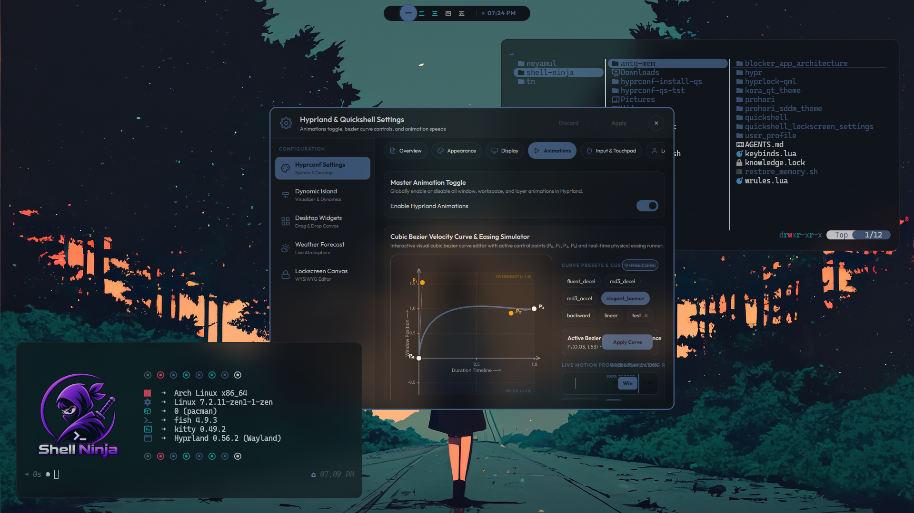
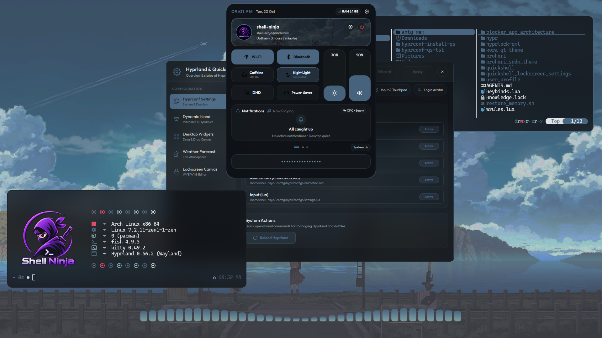
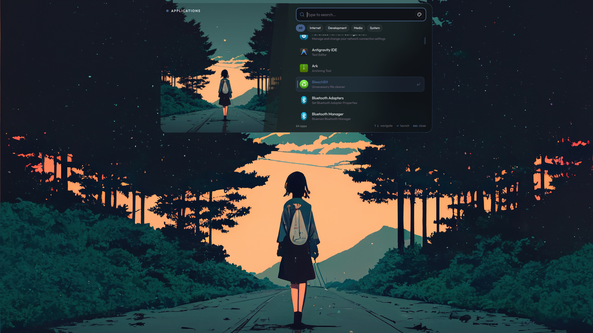
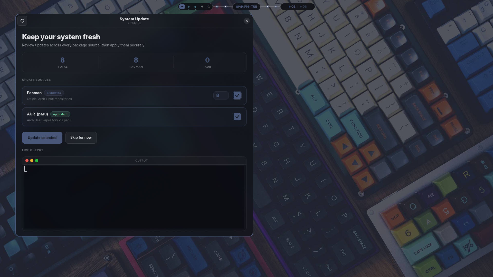
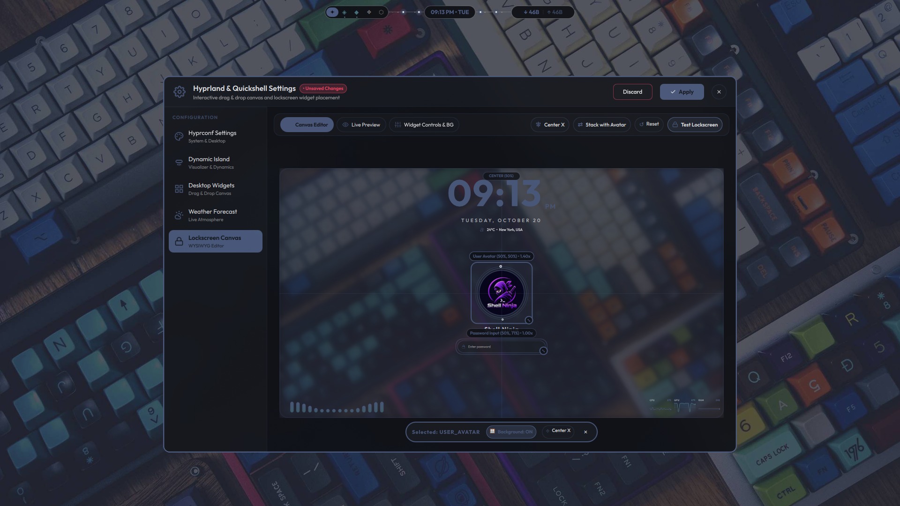

<a id="top"></a>

<h1 align="center">Hyprland TUI Installation Suite</h1>
<p align="center">
  <b>A modern, cross-distribution terminal installer for Hyprland and Quickshell</b>
</p>

<p align="center">
  <a href="https://github.com/shell-ninja/hyprconf-install/stargazers"></a>
  <a href="https://github.com/shell-ninja/hyprconf-install/network/members"></a>
  <a href="https://github.com/shell-ninja/hyprconf-install/blob/main/LICENSE"></a>
</p>

<div align="center">

<a href="#overview"><kbd> Overview </kbd></a>&ensp;&ensp;
<a href="#features"><kbd> Features </kbd></a>&ensp;&ensp;
<a href="#screenshots"><kbd> Preview </kbd></a>&ensp;&ensp;
<a href="#supported-distributions"><kbd> Distributions </kbd></a>&ensp;&ensp;
<a href="#installation"><kbd> Installation </kbd></a>&ensp;&ensp;
<a href="#contributing"><kbd> Contributing </kbd></a>

</div>

<br>

---

<a id="overview"></a>

## Overview

**hyprconf-install** is an interactive, automated installer engineered to deploy a fully configured **Hyprland** Wayland compositor environment and the **Quickshell** desktop suite.

The installer handles package management, dependency resolution, hardware-specific drivers (including NVIDIA proprietary setups), display managers (SDDM with custom themes), shell environments, font packages, and toolkit theming across multiple Linux distributions through a modern Terminal User Interface (TUI).

> [!TIP]
> If you are installing this on a production system, consider creating a system snapshot (e.g. Timeshift or Btrfs snapshot) beforehand.

<br>

<a id="features"></a>

## Features

- **Modern TUI Interface**: Built with an interactive terminal UI featuring live progress tracking, status capsule toggles, carousel selectors, and an embedded sub-terminal streaming package manager outputs.
- **Cross-Distribution Architecture**: Tailored deployment routines for **Arch Linux**, **Fedora**, **openSUSE**, and **Debian/Ubuntu** systems.
- **Hardware-Aware Driver Setup**:
  - Automatic detection and configuration of proprietary **NVIDIA** drivers, kernel parameters, and environment flags.
  - Automatic hardware chassis detection with tailored laptop gesture and power-saving profiles.
  - PipeWire audio server and Bluetooth stack configuration.
- **Unified Visual & Toolkit Theming**:
  - Automatically installs and configures `adw-gtk3-dark` for dynamic, wallpaper-based color switching.
  - Bundles and extracts the `kora` icon theme and `Bibata-Modern-Ice` cursor suite.
  - Synchronizes theme tokens across GTK 2, GTK 3, GTK 4, GSettings, xsettingsd, Qt5 (`qt5ct`), Qt6 (`qt6ct`), and KDE globals.
- **Stealth Background Prefetching**:
  - Downloads and verifies the configuration payload silently in the background while system packages compile and install.
  - Hands over control to the configuration wizard at completion with zero perceptible download delay.
- **Safe State Management**:
  - Automatically creates timestamped backups of existing `~/.config/hypr` and `~/.hyprconf` configurations before making changes.
  - Generates comprehensive execution logs in `Logs/` for effortless troubleshooting.

<br>

<a id="screenshots"></a>

## Desktop Environment Preview

The installer deploys and configures a complete, hardware-accelerated **Quickshell** desktop environment on top of **Hyprland**:

<div align="center">
  
  
</div>

<br>

<div align="center">
  
  
</div>

<br>

<div align="center">
  
  
</div>

<br>

<div align="center">
  
  
</div>

<br>

<div align="center">
  
  
</div>

<br>

<a id="supported-distributions"></a>

## Supported Distributions

| Distribution | Package Manager | Status | Notes |
|:---|:---:|:---:|:---|
| **Arch Linux** / EndeavourOS / Garuda / CachyOS | `pacman` + `yay`/`paru` | Tier 1 | Full support including AUR packages |
| **Fedora** / Nobara | `dnf` + Copr | Tier 1 | Full support with COPR repository setup |
| **openSUSE** (Tumbleweed) | `zypper` + OPI | Supported | Package routines updated |
| **Debian** (Testing/Sid) / **Ubuntu** | `apt` | Supported | PPA and pre-compiled binary fallbacks |

<br>

<a id="installation"></a>

## Installation

### 1. One-Line Direct Installation (Recommended)

Run the remote bootstrap runner directly in your terminal without manually cloning the repository:

```bash
bash <(curl -s https://raw.githubusercontent.com/shell-ninja/hyprconf-install/main/direct_run.sh)
```

> [!NOTE]
> Make sure `curl` and `git` are installed on your system before executing the one-line command.

### 2. Manual Installation

Clone the repository locally, set execution permissions, and start the installer:

```bash
# Clone the installer repository
git clone --depth=1 https://github.com/shell-ninja/hyprconf-install.git

# Navigate into the project directory
cd hyprconf-install

# Make the bootstrap script executable
chmod +x install.sh

# Launch the interactive installer
./install.sh
```

### Installer Controls

| Key | Action |
|:---:|:---|
| <kbd>↑</kbd> / <kbd>k</kbd> | Navigate to previous item |
| <kbd>↓</kbd> / <kbd>j</kbd> | Navigate to next item |
| <kbd>Space</kbd> / <kbd>Enter</kbd> | Toggle feature ON / OFF |
| <kbd>←</kbd> / <kbd>→</kbd> | Cycle carousel choices (SDDM theme, audio, shells) |
| <kbd>Tab</kbd> | Switch focus between settings and Install button |
| <kbd>q</kbd> / <kbd>Ctrl+C</kbd> | Cancel installation safely |

<br>

<a id="project-structure"></a>

## Repository Structure

```
hyprconf-install/
├── install.sh                  # Core CLI entrypoint & prerequisite verification
├── direct_run.sh               # Remote one-line curl runner
├── tui_installer.py            # Modern Python TUI installer orchestrator
├── interaction_fn.sh           # Terminal interaction primitives & styling functions
├── assets/                     # Bundled icon packs, cursors, and desktop entries
│   ├── kora-2-0-5.tar.gz
│   ├── Bibata-Modern-Ice.tar.gz
│   └── hyprland.desktop
├── pacman-scripts/             # Arch Linux installation pipeline
├── dnf-scripts/                # Fedora installation pipeline
├── zypper-scripts/             # openSUSE installation pipeline
├── apt-scripts/                # Debian/Ubuntu installation pipeline
├── common/                     # Cross-distribution modular scripts
│   ├── themes.sh               # GTK/Qt/KDE theming and asset deployment
│   ├── sddm_theme.sh           # SDDM greeter installation (Prohori / SilentSDDM)
│   ├── desktop.sh              # Chassis detection & desktop optimization
│   ├── bluetooth.sh            # Bluetooth daemon & manager setup
│   └── hyprconf.sh             # Hyprconf payload handoff & dotfiles deployment
└── shell/                      # Starship and shell configuration presets
```

<br>

<a id="contributing"></a>

## Contributing

Contributions, bug reports, and improvements are always welcome!

1. **Fork** the repository on GitHub.
2. **Clone** your fork locally:
   ```bash
   git clone --depth=1 https://github.com/your-username/hyprconf-install.git
   cd hyprconf-install
   ```
3. Create a feature branch:
   ```bash
   git checkout -b feature/my-enhancement
   ```
4. Commit your changes with descriptive messages:
   ```bash
   git commit -m "feat(pacman): improve repository mirror fallback"
   ```
5. Push to your branch and open a **Pull Request** against the `main` (or `development`) branch.

<br>

<a id="credits"></a>

## Acknowledgements

- Inspired by [JaKooLit](https://github.com/JaKooLit)'s Hyprland installation scripts.
- Maintained by [Shell Ninja](https://github.com/shell-ninja).
